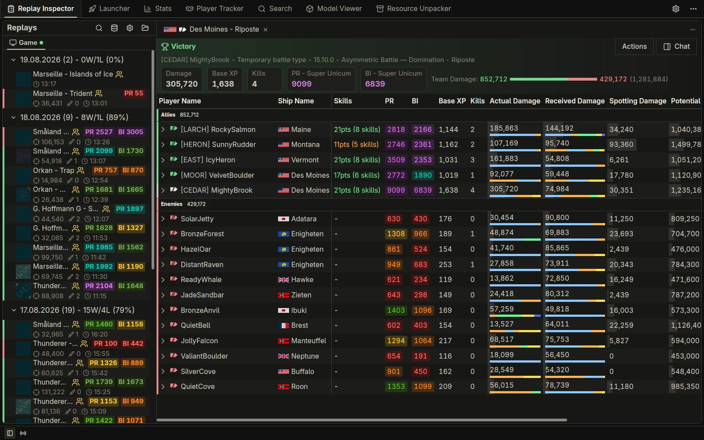
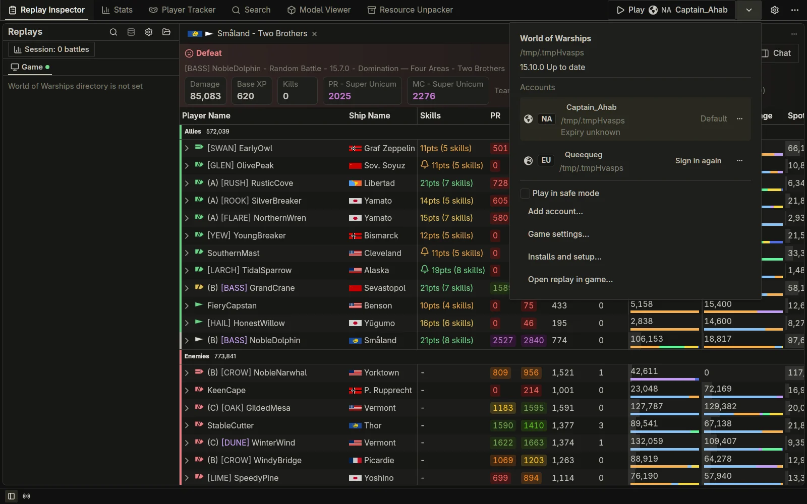
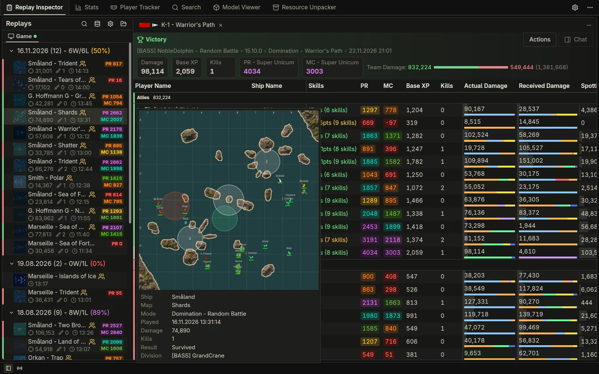
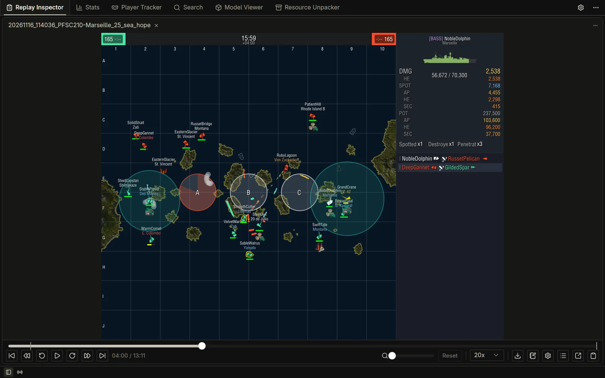
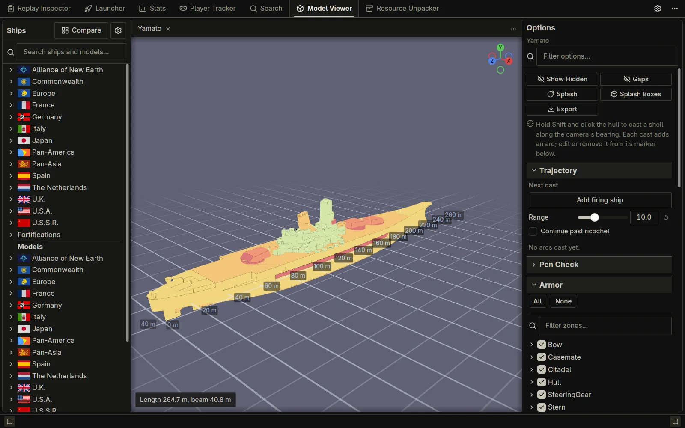
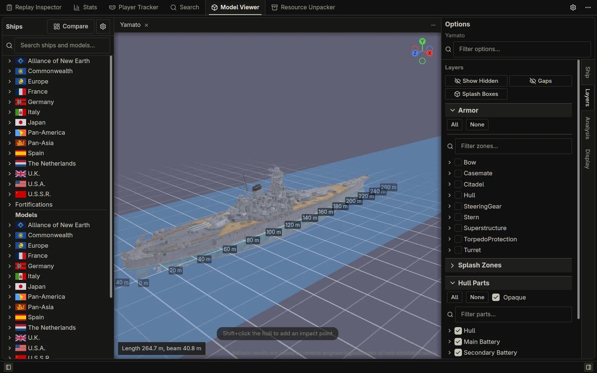
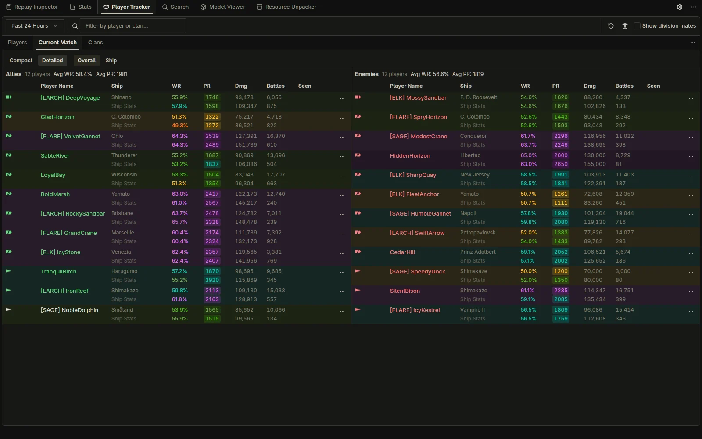
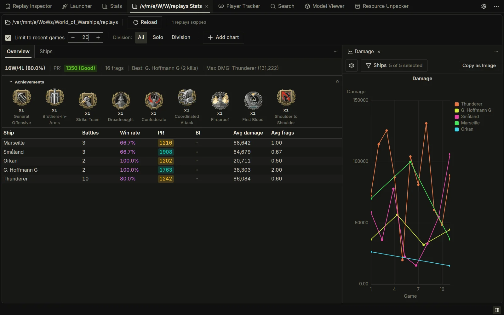

# Release Notes

Player-facing highlights for each release. New entries are generated from `Release-Note:`
commit trailers via `cliff-release.toml`; see that file for the convention. The full,
per-commit history lives in `CHANGELOG.md`.

## 1.1.0

- The new interface from the 1.1 betas is now the only interface. The old one is removed.
- Your settings, replays, replay index and session stats carry over. You don't need to set anything up again.
- On Linux, a new launcher signs in to your Wargaming account, installs and updates the game, and starts it through Proton.
- Match contribution (MC) rates a player's performance in one battle on the personal rating (PR) scale.
- The replay renderer plays at 30 frames a second, has drawing tools without a collab session, and takes a third to nearly half less time per frame.
- The Model Viewer opens any model in the game, including armored buildings and gun mounts.
- Session stats can chart almost any battle statistic and leave out ships, games or days.
- Every language is fully translated.

### New interface

- Panels dock, split and move by dragging their tabs.
- The interface has light and dark themes and zoom shortcuts. You can select and copy text.
- Settings open in a drawer with a search box. A setting in error is marked, and a warning's button opens the setting it is about.
- A status bar holds side panel toggles, running jobs with their progress, the collab session control and held modifier keys.
- Messages appear at the bottom right above the status bar. They no longer cover the Play button or the tab strip.
- Ctrl+K opens the command palette. It ranks matches fuzzily, and every list filter in the app marks the letters it matched. Escape clears a filter.
- On first run the app picks your system language and a game install it finds.
- Your Player Tracker view settings and saved stats charts are imported from the old interface once.
- The crash dialog links to GitHub and Discord and can clear your settings. License notices are shown in the app.

### Launcher on Linux

- The launcher is opt-in. Turn on Enable game launcher in settings to get a Play button and saved accounts. Wargaming does not support this way of playing.
- Sign in to your Wargaming account, update or install the game, and start it. You choose the destination folder before an update starts.
- The game runs through Proton or umu on an overlay of the install. Each install keeps its own shader cache.
- Safe mode applies to every way you start the game.
- Steam installs play through Steam by default. You can switch each Steam install to the Wargaming login instead.
- Account rows show when a session expires and have a Sign out action.
- Sign-ins are kept in the system keyring. Without a keyring they are saved to an unencrypted file, and the launcher tells you so.
- The Play button keeps its size and place while the game starts and runs.
- The Wine processes started by the toolkit end when the game exits or is stopped.

### Replay inspector and listing

- Replay folders open as tabs in the listing. Drop a folder to open it, or drop several replays to list them in a tab of their own. Subfolders are listed, indexed and watched too.
- Listing rows show a map thumbnail, the result, PR and MC. The listing's options choose what else each row shows: division, Twitch, damage, kills and battle time.
- Hover previews start at the battle start, not at the countdown.
- Rows are ordered by battle time. Open folders stay at the top while their contents scroll past.
- New battles are announced, briefly highlighted and tagged New. The listing keeps its scroll position, selection and closed groups when a battle lands.
- Group headers count only Random and Ranked battles in their win rate, colored by band. A listing option counts every game mode instead.
- Right-click a date or ship group to set or add it as session stats, or to render it to video or the clipboard. Right-click a replay to render it.
- Rendering a replay to a file or the clipboard uses your saved renderer options, such as your own ship's range circles.
- Battles played while the app was closed are indexed when it starts, and exported when auto-export is on.
- The replay header shows the result, stat tiles, your damage split and the match date. Hover the date to see how long ago it was.
- Hovering a replay's tab title marks its row in the listing.
- The player table can reorder, pin and auto-fit columns. Damage cells show the mix of damage types and each player's share of the team total.
- Ribbons and achievements are laid out as grids. Ship names show nation flags, and a disconnect time is a chip you can click to copy.
- The match timeline sits beside the table and keeps its filters. The Actions menu also opens it in a window with search, copy and save.
- The raw JSON side panel is highlighted and searchable.
- Fire chance names the ships and modifiers behind it.
- Enemy builds show once another recording of the same battle is merged in.
- Players seen in the Twitch chat you monitor around a battle are flagged in the replay panel and in the listing.
- The Anonymize player names option shows generated names and clan tags everywhere in the app. Exports keep the real names.
- Changing the language updates replays that are already open.

### Ratings

- Match contribution (MC) rates one battle on the PR scale. It is shown beside PR in the replay table, search results and stats.
- Hover PR or MC to see what it is made of.
- PR and MC are shown only for Random and Ranked battles. Other battle types show a dash that explains why.
- A new battle's PR and MC appear as soon as it lands. Replays indexed before the rating table arrived are rated once it does.

### Replay renderer

- Playback runs at 30 frames a second at every speed. Ships, shells, torpedoes, planes and smoke move smoothly between recorded frames, and seeking lands on the exact time.
- The battle clock counts down once per game second.
- The renderer draws at the screen's full resolution, so it stays sharp in a large window or on a high-DPI display.
- Drawing tools and undo work without a collab session. Shapes can be filled, have a custom ink, and are edited from a popup beside the picked drawing. Clear All removes every drawing.
- Right-click puts a drawing tool down. The mouse wheel turns a ship you are placing.
- Measurements show a tick every half kilometer and their total length.
- Trails use every recorded position. Speed trails, dead ship trails and the score timer can be turned on and off.
- The camera direction is drawn as a wedge under each ship icon.
- The stats panel is available in the renderer and in video exports.
- Event jumps say which event they landed on, and the speed is shown when a key changes it.
- The export settings fit a video to a length or play it at a speed. Batch renders use the same setting.
- Exported videos include trails, drawings and range circles, and are named by battle start, player, map and ship. The renderer says where a video was saved or that it was copied.

### Armor and Model Viewer

- The options panel is grouped into Ship, Layers, Analysis and Display tabs. Its search covers every tab.
- Shift+click the hull to cast a shell. The trajectory editor lists each plate the shell struck with its thickness, impact angle, zone and what the shell did there.
- Click a salvo or shell in the incoming fire log to draw its path through the hull. Each salvo names its shell, caliber and range.
- A ship placed from a replay shows a compass rose that turns with its heading, and a health strip labeled with the battle clock.
- The Layers tab lists a ship's splash boxes by group.
- Ship searches list the closest matches first. Clicking a ship loads it without unfolding its parts.
- Ctrl+Z, Ctrl+Shift+Z and Ctrl+S work anywhere in the viewer.
- The viewer starts with the water off and the grid on.

- The Model Viewer opens any model in the game, including armored buildings under Fortifications and their gun mounts.
- Hover a model to see the name of the part under the pointer.
- Models list the textures they use. Normal and metal-gloss maps are drawn and included in GLB exports.
- Search ships and models by name or game ID, and filter ships by a tier range.

### Player Tracker

- Current Match, Players and Clans are panels you can place side by side. The layout and your filters are saved.
- Current Match shows team averages for win rate and PR, colored by the band each value falls in. Ship class icons keep their proportions.
- Players from every indexed replay are recorded, and division mates are marked. Populate fills the tracker from the replay index.
- Players seen in Twitch chat during a battle with you show a Twitch icon naming their login. The Seen in Twitch chat box narrows the list to them.
- The tables refresh when a battle is recorded while the tab is open.

### Stats

- Session stats can hold your saved session or every battle since the app opened. Choose from the listing's options or the Stats tab.
- Battles you play are added to session stats as the game writes them.
- Charts can plot potential damage, damage received, hits, fires, floods, citadels, critical hits, distance traveled, capture points, planes shot down, anti-air damage, time lived, survival rate, torpedoes spotted, heals and MC. Pick one from a list that narrows as you type.
- Battles saved before these statistics were kept are left out of their charts. Rebuilding the replay index fills them in for saved session battles whose replays are still on disk.
- Leave ships, single games or days out of the stats. Reset filters shows every game again.
- Hover a point or bar to see its value. Drag or scroll over an axis to stretch or squeeze that axis alone.
- Random and Ranked win rates are colored by band in the session record, the Ships panel and the charts.

### Search, Unpacker, tactics board and collaboration

- Search pills name the players, ships and folders they filter on. Results can pin columns and render a replay to the clipboard. A search runs again when new battles are indexed.
- The Unpacker's file viewer supports text selection, copy and find with match case. Filter results show their folder.
- The tactics board sets a placed ship's hull, Concealment Expert, range upgrades and range circles. Picked shapes are edited from the toolbar.
- A peer's pointer shows only on the replay or board it is over, under that peer's name.
- Watchers of a collab session follow the host's layers, range circles and trails. The watched view can zoom and pan, and shows peers, pings, drawings and the score bar.

### Translations

- Every language is fully translated, including strings that were left in English.
- Counted text, such as a number of battles, uses each language's plural forms.
- You can correct a translation without a new release. Put a `translations/<language>.ftl` file next to the app, for example `translations/de.ftl`. The messages it names replace the bundled ones.

### Fixes

- PR, MC and stats win rates count only Random and Ranked battles. Ratings stored for other battle types are cleared from the replay index.
- The player stats lookup waits up to a minute and retries a request that timed out once.
- A battle is auto-exported when its results arrive after you leave early. Exports use the game's clan colors, keep each player's ship data attached, and leave out placeholder ship and captain names.
- The game's temporary replay file is no longer read while a battle is in progress.
- A replay the game rewrites is indexed again.
- The replay index keeps matching when the install folder is reached through another path, such as a symlinked mount point.
- Old replays keep their retired module and skill icons.
- Hits that land in the same tick are all counted in merged damage events.
- In a playback merged with another team's recording, enemy icons are no longer all shown as spotted.
- Shared replays are recorded as sent only when ShipBuilds accepts them, so a failed upload is sent again later. Replays that cannot be read are skipped.
- Beta updates are offered only to beta builds. On Windows an update is offered only once its archive is uploaded.
- The macOS app starts on a Mac without Nix.

### Performance

- Each rendered frame takes a third to nearly half less time, in the renderer and in exported videos, because the map layer is composited in about a tenth of the time.
- Large and high-DPI windows show the battle moving every frame, because several frames are drawn at once.
- The palette index, the Unpacker's folder trees, the renderer's roster and folder checks are read off the UI thread. Long jobs run on their own pool, so the listing and thumbnails stay responsive during indexing and downloads.
- Waiting screens redraw at 10 frames a second instead of the display rate.
- The Model Viewer decodes each model and texture once per ship and loads the default view first. Only the newest camouflage pick is decoded.
- The armor viewport keeps the drawn scene while only its overlay animates.

### Other

- Generate game constants from the installed client when none are published for its build yet. The status bar says when it runs and how it went.
- The app can run an MCP server from settings, so AI assistants can query your replays and game data.
- The command palette can open any ship in ShipTool. The build link in a player's menu reads Open Build in WoWs SB.
- The app warns once game data loads if the install folder lists no replays.
- Windows show the application icon, including in their title bar.
- Settings from versions old enough to keep them in `app.ron` are moved into the new settings store on first start.

### Command-line tools and libraries

- The desktop app runs replayshark commands as `wows_toolkit replayshark <args>`.
- The minimap renderer CLI takes `--video-length` or `--speed`, and `--max-size-mib` refuses a size the video cannot fit.
- wows-query adds computed ballistics and torpedo quantities, battle impact factors, `salvo_kill`, `gun_module_matchups`, `torpedo_rankings`, `module_comparison`, historical IFHE and skill dispersion, and AP penetration by range.
- wows-mcp is a library that embedders extend with their own tool sets. Raw GameParams are stored as a deduplicated memory-mapped tree with jq queries.

## 1.1.0-beta6

### Stats

- Charts can plot many more statistics: potential damage, damage received, hits, fires, floods, citadels, critical hits, distance traveled, capture points, planes shot down, anti-air damage, time lived, survival rate, torpedoes spotted, heals and match contribution. Pick one from a list that narrows as you type.
- Battles saved before these statistics were kept are left out of their charts rather than counted as zero. Rebuilding the replay index fills them in for saved session battles whose replays are still on disk.
- Leave ships, single games or days out of the stats. The filter bar picks the ships and a span of days, a Matches panel keeps or leaves out each game, and Reset filters shows every game again.
- Drag or scroll over a line chart's axis to stretch or squeeze that axis alone.
- Random and Ranked win rates are colored by the same bands as the Player Tracker: in the session record, the Ships panel, chart tooltips and chart value labels.

### Replay listing

- The listing's options choose what each row shows: PR, MC, division, Twitch, damage, kills and battle time. A row without its stats line centers its name on the map.
- A row shows the Twitch logo when another player in the battle was seen in the Twitch chat you monitor. Its hover card names each of them and their Twitch login.
- Group headers count only Random and Ranked battles in their win rate, colored by its band. A listing option counts every game mode instead.
- The session stats scope moved from the header chip into the listing's options.
- Hover previews start when the battle starts, not at the countdown.
- Replays are ordered by battle time.
- Open folders stay at the top of the listing while their contents scroll past. The armor viewer sidebar and the unpacker folder tree do the same.

### Player Tracker

- Players seen in Twitch chat during a battle with you show a Twitch icon naming their login. The Seen in Twitch chat box narrows the list to them, and the games-together columns show how many battles you have had with them.

### Replay renderer

- Large and high-DPI windows show the battle moving every frame, because several frames are drawn at once.
- Each rendered frame takes a third to nearly half less time, in the renderer and in exported videos.

### Other

- The build link in a player's menu reads Open Build in WoWs SB.
- Windows show the application icon, including in their title bar.

## 1.1.0-beta5

### Ratings

- Match contribution (MC) rates a player's performance in one battle on the personal rating (PR) scale. It is shown beside PR in the replay table, search results and stats.
- Hover PR or MC to see what it is made of.
- PR is shown only for Random and Ranked battles. Other battle types show a dash that explains why.
- A new battle's PR and MC appear as soon as it lands. Replays indexed before the rating table arrived are rated once it does.

### Replay listing and session stats

- Session stats can hold your saved session or every battle since the app opened. Choose from the session chip in the listing header or in the Stats tab.
- Battles you play are added to session stats as the game writes them.
- Right-click a date or ship group to set or add it as session stats, or to render it to video. Right-click a replay to render it.
- Battles played while the app was closed are indexed when it starts, and exported when auto-export is on.
- Opening a replay folder also lists, indexes and watches its subfolders.
- The listing keeps its scroll position, selection and closed groups when a battle lands or the folder is read again.
- The Anonymize player names option shows generated names and clan tags everywhere in the app. Exports keep the real names.
- Players seen in the Twitch chat you monitor around a battle are flagged in the replay panel.
- A replay's Actions menu opens a Match Timeline window with filters, search, copy and save.
- Changing the language updates replays that are already open.

### Replay renderer

- Playback runs at 30 frames a second at every speed. Ships, shells, torpedoes and planes move smoothly between recorded frames, and seeking lands on the exact time.
- Drawing tools and undo work without a collab session. Shapes can be filled, Clear All removes every drawing, and a popup edits the picked drawing.
- Measurements show a tick every half kilometre and their total length.
- The stats panel is available, and video exports include it.
- Trails use every recorded position. Speed trails, dead ship trails and the score timer can be turned on and off.
- The camera direction is drawn as a wedge under each ship icon.
- Exported videos include trails, drawings and range circles, and are named by battle start, player, map and ship.
- The renderer draws at the screen's full resolution, so it stays sharp in a large window or on a high-DPI display.

### Armor viewer

- The options panel is grouped into Ship, Layers, Analysis and Display tabs. The search covers every tab.
- The trajectory editor lists each plate a shell struck, with its thickness, impact angle, zone and what the shell did there.
- Click a salvo or shell in the incoming fire log to draw its path through the hull.
- The Layers tab lists a ship's splash boxes by group.
- Searching for a ship lists the closest matches first.
- Clicking a ship in the sidebar loads it without unfolding its parts. The arrow unfolds them.
- Ctrl+Z, Ctrl+Shift+Z and Ctrl+S work anywhere in the armor viewer.
- The viewer starts with the water off and the grid on.

### Player Tracker

- Players from every indexed replay are recorded in the Player Tracker, and division mates are marked. Populate fills the tracker from the replay index.
- Ship class icons in Current Match keep their proportions.
- The tables refresh when a battle is recorded while the tab is open.

### Tactics board and collaboration

- A placed ship's hull, Concealment Expert, range upgrades and range circles can be set.
- Watchers of a collab session follow the host's layers, range circles and trails.
- A peer's pointer shows only on the replay or board it is over, under that peer's name.

### Game data and launcher

- Game constants are generated from the installed client when none are published for its build yet.
- Wine processes started by the toolkit end when the game exits or is stopped.

## 1.0.5

### Replay analysis

- Current Match finds the players in 15.10 battles and looks up their stats again. The client added a roster field, which made every player look like a bot.
- 15.10 replays show teammates in friendly colors with their names, including in event battles.
- Event capture zones are drawn where they are in the battle instead of in a row along the top of the map.
- The Replay Inspector breaks down spotting damage. Hover or expand a player's spotting figure to see how much each spotted ship took, and for your own ship which weapon types dealt it.
- Potential damage keeps its breakdown when a replay has no battle results.

### Replay renders

- Long names and messages in the activity panel wrap instead of running off the edge.
- Activity panel rows alternate background shades, and new entries slide into place.

## 1.0.4

### Replay analysis

- Builds in 15.10 replays show their upgrades, consumables and signals. The client changed how it records upgrade slots, which left most of each build empty.
- 15.10 replays that were already indexed are read again once after you update.

### Tools and builds

- The macOS app is published again.

## 1.0.3

### Replay analysis

- Replays from newer client builds use their matching roster layout when an exact constants file is unavailable. This keeps the application from failing while opening a replay with older fallback constants.
- Replay rows indexed by an earlier parser refresh once, so a corrected victory or loss remains correct after leaving the inspector.
- Player action menus can open ship builds in ShipTool. EU WoWS Numbers links use the canonical domain.
- The command palette can copy application, game-data, constants-fetch, and recent-crash information for bug reports.
- The command palette can open any ship in ShipTool.
- Replay directory tabs have a Directory Stats button. It opens a Stats tab for every replay in the directory and its subdirectories, and reports which replays it skipped and why.
- Current Match looks up player stats only after you open the Current Match view.
- Replay listing no longer fails while loading game data when the replay folder is on a file system without file creation times, such as an NTFS drive mounted on Linux.
- Opening a replay with an unrecognized ship configuration layout no longer stalls.

### Armor viewer

- Changing a trajectory's range updates its path through every armor plate.
- Detonation results name the correct compartment. A shell that ricochets off or shatters on a plate detonates outside the compartment behind it, and internal decks and bulkheads no longer move a detonation out of the citadel.
- The 3D viewport shows colors at the correct brightness. They were previously too dark.
- Dragging to pan moves the camera along the screen axes at every view angle. Shift+arrow keys also pan the camera.

### Interface

- File and folder pickers no longer freeze the window while they are open.
- The remaining untranslated UI text is translated in every supported language.

### Game data and compatibility

- GitHub constants checks remain available after the application fetches versioned constants in a background worker.
- Bundled replay constants match WoWs 15.10, and game data for 15.10 can be downloaded.
- Ship configuration and captain skill parsing handles current packet data, including the 15.9 exterior state layout, and older replay layouts.
- Ships in 15.9 and later replays show their consumables again, and bots are placed on the correct team.

## 1.0.2

### Replay analysis

- Replay parsing follows the 15.9 roster layout while retaining the older layout for earlier replays. Player teams and ship identities resolve correctly, and roster data links to vehicle packets so captain skills and ship configurations are retained.
- Normalized replay reports include stable player ordering, battle outcome, and ship identity. Replay analysis can resolve effective fire chance and track damage, spotting, and consumable use over battle time.
- `replayshark` can inspect rosters, battle results, and constants mappings.

### Game data and compatibility

- Game data downloads cover multiple required builds in one plan, deduplicate shared files, verify downloaded content, and report which build contains a corrupt file.
- Steam public-branch depot manifests are pinned for reproducible game data downloads. WoWs 15.8 data is included.
- Fixed `wows-data-mgr` link and library behavior when unused files are removed by aggressive cache cleanup.
- Ship configuration and captain skill parsing handles the current packet data and older replay layouts.

### Armor viewer

- The 3D model export dialog lets you select model export settings before writing a file.

### Performance and memory

- Game data loading uses less memory by storing VFS paths in one buffer, reducing per-entry index data, sharing skill lists, releasing unused parameter capacity, and loading asset paths only when required.
- Replay listing reuses indexed row summaries, avoiding repeated replay reads for unchanged files.
- Minimap rendering shares game fonts and limits its decoded map cache.
- Replay parsing reduces metadata copies and per-packet hashing, dispatch, and allocation work.

### Tools and builds

- The command-line tools archive restores the `wows-data-mgr` executable name and adds a CPU-only `minimap_renderer_cpu`.

## 1.0.0

We've reached 1.0! I'm calling it now: this will cause confusion for people who say "omg I have 1.70 I don't have this feature???" but no you are on _0.1.70_.

Anyways, the project has many good QoL features. It's worthwhile to just consider it 1.0 now.

High-level features/changes in this release:

- New **search tab** for searching historical replays (only going forward from this day as prior history was not recorded, sorry!). Queries are persisted across restarts.
- New **command palette** (Ctrl+K or Ctrl+P) for some quick actions/stuff that doesn't fit in the UI.
- You can **open directories of replays** from the command palette which will parse in a new tab. Right-click the tab to search that set of replays
- **Hover** a replay in the replay inspector to quickly preview its render
- **Player Tracker** has been revamped with separate tabs for **Clans**, the pre-existing Player Tracker tab has been slightly reworked, and a new **Current Match** tab has been added
- **Current Match** tab allows you to view team win rate / PR composition similar to tools like Potato Alert / Matchmaking Monitor which have already done this very well for a long time. This is something I've been hesitant to add for some time now as I feel these tools do this well and I don't like the impact it has on a player's mental state of the game. People want it though so here we are.
- Improvements to the **Armor Viewer**: some fixes relating to penetration mechanics, loading a ship's textures (this still has bugs but mostly works), and misc items on the boat such as lifeboats, propellers, and other 3D items that were previously not shown.
- Updated **look and feel**. Same UI framework with some custom styling tweaks.
- You can now opt-in to sending my ShipBuilds.com server **raw replays** instead of builds. There's nuance: if you're in a test ship, it will fall back to the old method of sending builds rather than the raw replay. Client-side filtering to Ranked/Random battles replays is still performed. This will allow me to do richer server-side analysis for things like death heatmaps and correlate lag detection in matches with other toolkit users. 
- Blocked **shitware** from injecting **shit** into WoWs Toolkit which would generally cause odd behaviors (crashing, Discord overlay, Steam overlay, etc.). This might block some form of text input, and can be disabled in settings for users who need it (look for code integrity setting).

The rest is an AI-generated summary of a bunch of changes:

**Search and the command palette**

- New Search tab: build a query by clicking filters, or type it directly, with boolean AND/OR/NOT, grouping, "any player" / "all players" quantifiers, relative dates, and suggestions as you type.
- Results are sortable, preview the map on hover, copy a replay's path, and open a replay in its own tab.
- Your query is remembered across restarts, and edits can be undone and redone.
- A command palette on a hotkey jumps straight to players, ships, replays, and actions from anywhere in the app.

**Replay browsing**

- The replay listing is backed by a durable index, so it opens without parsing every file, and each row shows the result, ship, and stats on two lines.
- Any replay directory can be opened as its own closeable tab and searched from there.
- Hovering a replay row plays a looping minimap preview of that match.
- New match timeline window in the replay inspector.
- When a replay needs game data you do not have, the toolkit says so and offers to download exactly the builds it needs.

**Player tracker**

- Current Match reads the live roster from the battle in progress, split by team, with ships, win rate, PR, battles, average damage, and per-ship PR, plus links out to wows-numbers and ShipBuilds.
- New Clans sub-tab breaks your encounters down by clan over a selectable time range.
- Division mates are marked per encounter rather than per account, historical rows collapse with an expandable notes block, and disconnects and stream-snipers are flagged.

**Armor viewer**

- Camouflages now render on ship models, with a camo picker per pane.
- Ships draw their misc parts: propellers, boats, and deck fittings.
- Multi-pane comparison with mirrored cameras and synced settings, hull LOD / upgrade / module reload, and GLB export with optional armor and selectable texture detail.
- Penetration is more accurate: the fuse arms against effective armor, and fuse travel converts at the ship-model scale.

**Fire chance analysis**

- Your effective fire chance for the match, broken down by the HE hits behind it, with an explanation for every fire ribbon that did not get credited.

**Look and feel**

- New Graphite & Bone theme and a light mode, with every colour contrast-checked for legibility.
- Cleaner dock tabs, tidier tables, and a large number of layout and spacing fixes throughout.

**Sharing**

- Explicit data-sharing modes with consent dialogs: share nothing, share build data, or share raw replays. Opting down never silently escalates.
- Batch-upload your open replays to ShipBuilds with progress. Test ships are never uploaded, and raw replays only upload once a battle has actually finished.

**Performance**

- Much faster replay loading, and directory scans now read headers only, spread across every core.
- Noticeably lower memory use when loading game data.
- Camouflage loading is dramatically faster: composited on the GPU and decoded on background workers instead of stalling the UI.

**Important fixes**

- The renderer pins a working GPU driver and falls back if a launch hangs, and reports a failed startup instead of exiting with no window.
- Optional blocking of third-party code injecting itself into the toolkit's process.
- The auto-updater no longer grabs the command-line tools zip by mistake, and update finalization handles both old and new argument forms.
- Freshly written replays are parsed off the UI thread with retries, so the app no longer stutters or dies when a battle ends.
- Crew skills are no longer discarded on some game builds, and ship config dumps match the in-game description, including old versions.
- Exported videos are named with the battle timestamp first.

### Command-line tools and libraries

- Replay parsing is substantially faster: zero-copy metadata APIs, streaming interleaved Blowfish decrypt, and per-packet hashing, dispatch, and allocation costs cut across the board. `replayshark bench` profiles the load path.
- wowsunpack discovers universal camouflages via `isTileflage` on Exterior params (skipping death skins), extracts hull `burnNodes` and length, and builds the VFS index without copying it three times.
- wows-battle-world gained fire-analysis logging: burn-bit transitions, timestamped self ribbons, AOI presence windows, and hit history. `BattleReport::players` now has a stable order, and a loss carries the real winning team id.
- wows-replay-insights adds an egui-free `NormalizedBattleReport`, per-victim burn-state and damage-control tracks, and a headless effective-fire-chance resolver with corpus measurement.
- A new SQLite replay index provides match and roster predicates, facet queries, live ingestion, panic-isolated backfill and reconcile, boundary-checked source relocation, and per-source row summaries.
- minimap-renderer bakes bounded preview tracks in a single forward pass behind a dwell gate.
- replayshark adds `query roster`, a battle-results dump command, and a constants resolver with approximate-match classification.
- wows-data-mgr plans deduplicated multi-build downloads, shares one HTTP client, downloads sequentially into the shared CAS, and verifies object hashes, naming the build a corrupt object breaks.

## 0.1.70

### WoWs Toolkit

**Highlights**

- AV1 should now be available as a video export codec (an issue with the automated builds kept it from surfacing before).
- Old game-version data loads should not require administrator permissions/Windows Developer Mode to create symlinks. Instead uses pre-existing metadata to load from content-addressed storage.

**Important fixes**

- Video export should no longer fail partway through with some codecs (EmptyVideoFrame error).
- Single-replay renders default to the stats panel again; team rosters remain the default only for merged replays. This was an unintentional change previously.
- Fix issue with not being able to see ship-specific context menu items in live replay renderer when player names were disabled.

### Command-line tools and libraries

- Far more detailed ship stats extracted from game data: artillery and dispersion, per-caliber secondaries, torpedoes, concealment, durability, mobility, and consumables resolved with upgrades, skills, and signals applied, plus a per-stat breakdown of what each input contributes.
- Faster GameParams parsing and lower memory use.
- wowsunpack, replayshark, wows-data-mgr, and minimap_renderer now ship as platform-named zips (wows_toolkit_tools_<version>_<platform>.zip).

## 0.1.69 - 2026-06-11

**Highlights**

- Compare replays side by side: merge multiple per-player replays into a single rendered view, with team roster panels and merged camera perspectives.
- Video export now supports multiple codecs (H.264, H.265, and AV1) with a configurable bitrate / target file size.
- Armor viewer hull lighting: realistic shading with In-Game / Flat / Studio presets, full controls (direction, intensity, rim, specular, colors), a light-source marker, and a detachable settings window.
- Replay view shows each player's consumable inventory and equipped module loadout.
- Game data for older client versions downloads on demand, and the local cache is validated against the remote and kept up to date automatically.
- Broad support for old replays (back to ~0.7.x): correct assets, ranges, captain skills, consumable IDs, and chat/voiceline names.
- Web (WASM) build support.

**Important fixes**

- Smoother rendering on Windows and fixes to render-backend selection (resolves window-drag stutter).
- Linux/macOS: fixed "permission denied" when extracting game files (#35).
- Smoother ship motion on the minimap (full-precision positions, per-variant interpolation instead of snapping).
- Shell tracers are paced by server time-to-impact for more accurate timing.
- More reliable networking: honors the OS trust store for HTTPS, with timeouts, retries, and validation of downloaded data.
- Correct healing / regeneration display while a ship is repairing.
